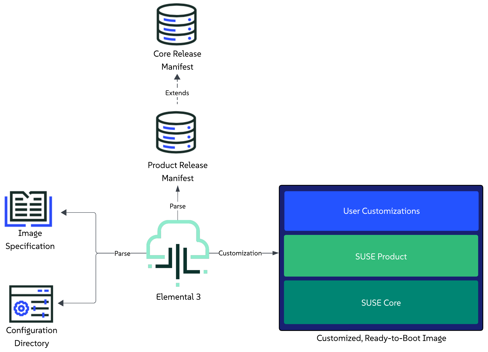

# Image Customization

This section provides an overview of how the `elemental3` command-line interface enables users to customize and extend an image that is based on a specific set of components defined in a [release manifest](release-manifest.md).

For general information about the customization process, refer to the [Customization Process](#customization-process) section.

For information on booting images in air-gapped environments, refer to the [Air-gapped images](#air-gapped-images) section.

For information on how to boot a customized image, refer to the [Booting a customized image](#booting-a-customized-image) section.

For real-life examples, refer to the deployment scenario examples in the [Cookbook](../docs/cookbook-first-time-use.md#scope-and-audience) documentation. 

## Customization Process

The customization process is executed through the `elemental3 customize` command.

As part of the command, users are expected to provide:

1. **Specifications for the image** - these are defined as options to the command itself. Available specification options can be viewed by calling the command's help message: `elemental3 customize -h`.
2. **Information about the desired state of the image** - this is done through the definition of a configuration directory that the user creates beforehand. For more information on the directory itself, refer to the [Configuration Directory Guide](configuration-directory.md).

Please familiarize yourself with both points before attempting to customize your first image.

For further understanding of the customization process, you can also refer to the following sections:

- [Limitations](#limitations) - for any limitations that the process might have.
- [Overview](#overview) - for a high-level description of the steps that the customization process goes through.
- [Execution](#execution) - for supported methods to trigger the customization process.

### Limitations

Currently, the image customization process has the following limitations:

1. Supports customizing images only for `x86_64` platforms.

Elemental is in active development, and these limitations **will** be addressed as part of the product roadmap.

### Overview

> **NOTE**: The user is able to customize Linux-only images by **excluding** Kubernetes resources and deployments from the configuration directory (regardless of whether this is under `kubernetes/manifests`, `kubernetes/cluster.yaml` or `release.yaml`). This is currently an implicit process, but it is possible that an explicit option for it (e.g. a flag) is added at a later stage.

This section provides a high-level overview of the steps that Elemental's tooling goes through in order to produce a customized and extended image.

*Steps:*
1. Parse the user provided image specifications.
1. Parse the configuration directory that the user has defined in the image specification.
1. Parse the [solution release manifest](release-manifest.md#solution-release-manifest) that the user has defined as a [release reference](configuration-directory.md#solution-release-reference) in the `release.yaml` file of the configuration directory.
1. Pull and parse the [core platform release manifest](release-manifest.md#core-platform-release-manifest) that the aforementioned solution manifest extends.
1. Begin the customization process:
   1. Unpack the pre-built installer ISO that is defined in the `core platform` release manifest.
   1. Prepare for Kubernetes cluster creation and resource deployment:
      1. Prepare Helm charts and Kubernetes manifests
      1. Download RKE2 artifacts (tarball, checksums) and install script.
      1. For [air-gapped images](#air-gapped-images), embed the Helm charts, the RKE2 container image tarballs, and the container images used by the workloads.
   1. Prepare any other overlays or firstboot configurations based on what was defined in the configuration directory.
   1. Produce a description of the desired installation state and merge it with the installer ISO description.
   1. Produce the final desired image type.
1. Mark customization as completed.



### Execution

Starting the customization process can be done either by directly working with the `elemental3` binary, or by using the `elemental3` container image. Below you can find the minimum set of options for running both use cases.

#### Binary

```shell
sudo elemental3 customize --type <raw/iso> --config-dir <path>
```

> **IMPORTANT:** The above process is long running, as it involves pulling multiple component images over the network.
> Downloaded artifacts are cached under `<config-dir>/cache` and are reused for future runs.

Unless configured otherwise, after execution, the resulting ready-to-boot image will reside in the configuration directory path and use the `image-<timestamp>.<image-type>` naming format.

> **NOTE:** You can specify another path for the output using the `--output (-o)` option, however, be mindful if running Elemental 3 from a container,
> as it would require including the mounted configuration directory as a prefix (e.g. --output /config/<desired-path>).

#### Container image

> **NOTE:** This section assumes you have pulled the `elemental3` container image and referenced it in the `ELEMENTAL_IMAGE` variable.

Run the customization process:

* For a RAW disk image:
   ```shell
   podman run -it -v <PATH_TO_CONFIG_DIR>:/config $ELEMENTAL_IMAGE customize --type raw
   ```

* For ISO media:
   ```shell
   podman run -it -v <PATH_TO_CONFIG_DIR>:/config $ELEMENTAL_IMAGE customize --type iso
   ```

> **IMPORTANT:** The above process is long running, as it involves pulling multiple component images over the network.
> For a quicker execution of subsequent runs, mount a directory from the host at `/cache`:
>
>   ```shell
>   podman run -it -v <PATH_TO_CONFIG_DIR>:/config -v <PATH_TO_CACHE_DIR>:/cache $ELEMENTAL_IMAGE customize --type <raw/iso>
>   ```

Unless configured otherwise, the above process will produce a customized RAW or ISO image under the specified `<PATH_TO_CONFIG_DIR>` directory.

### Cache configurations

During the customization process, artifacts downloaded during customization can be optionally cached to speed up future builds.

The cache is controlled by the following `elemental3 customize` options:

* `--cache` - (Optional) Cache mode, `auto` if unspecified.
  * `auto` - serves cached artifacts and downloads any that are missing.
  * `offline` - serves cached artifacts only, never downloads and fails on the first missing artifact. For customizing images without reaching over the network.
  * `refresh` - discards the previously cached artifacts and downloads everything again.
  * `off` - neither uses nor populates the cache.
* `--local` - (Optional) Alias for `--cache offline`.

Default run, cached artifacts will reside under `<PATH_TO_CONFIG_DIR>/cache` on the host machine:
```shell
podman run -it \
  -v <PATH_TO_CONFIG_DIR>:/config \
  $ELEMENTAL_IMAGE \
  customize --type <raw/iso>
```

Offline run, only previously cached artifacts are used and the process fails if any of them is missing.
Adding `--network none` ensures nothing is downloaded during customization:
```shell
podman run -it --network none \
  -v <PATH_TO_CONFIG_DIR>:/config \
  -v <PATH_TO_CACHE_DIR>:/cache \
  $ELEMENTAL_IMAGE \
  customize --type <raw/iso> \
  --cache offline
```

Refresh run, previously cached artifacts are discarded and downloaded again:
```shell
podman run -it \
  -v <PATH_TO_CONFIG_DIR>:/config \
  -v <PATH_TO_CACHE_DIR>:/cache \
  $ELEMENTAL_IMAGE \
  customize --type <raw/iso> \
  --cache refresh
```

No cache run, artifacts will not be cached and previously cached artifacts will be ignored:
```shell
podman run -it \
  -v <PATH_TO_CONFIG_DIR>:/config \
  $ELEMENTAL_IMAGE \
  customize --type <raw/iso> \
  --cache off
```

> **NOTE:** A container image with the `latest` tag, is served from the cache until the cache is refreshed.

For locally built release manifests not served by a registry, the easiest way to seed them into the cache is:
```shell
podman push \
  localhost/release-manifest:dev \
  oci:<PATH_TO_CACHE_DIR>/oci:localhost/release-manifest:dev
```

## Air-gapped images

Passing the `--airgap` option to `elemental3 customize` produces an image that creates its Kubernetes cluster and 
deploys its workloads without any network access by embedding all of the necessary artifacts into the image at customization time.

This includes: 
* **Kubernetes** - the RKE2 container image archives for the core components and the CNI plugins.
* **Helm charts** - every configured Helm chart is pulled during customization and embedded into the built image.
* **Container images** - all container images specified and detected during customization time from:
  * templating every Helm chart with the respective settings and values and extracting the container images from the template,
  * collecting every image from each Kubernetes manifest,
  * images explicitly listed under `elementalEmbeddedRegistry.containerImages` in `kubernetes/cluster.yaml`.

At boot time an embedded registry is started by the `elemental-registry.service` that uses Hauler to serve the container images for the Kubernetes cluster.

Customizing an air-gapped image:

```shell
podman run -it \
  -v <PATH_TO_CONFIG_DIR>:/config \
  -v <PATH_TO_CACHE_DIR>:/cache \
  $ELEMENTAL_IMAGE \
  customize --type <raw/iso> \
  --airgap
```

## Booting a customized image

> **NOTE:** The below RAM and vCPU resources are just reference values, feel free to tweak them based on what your environment needs.

The customized image can be booted as any other regular image. Below you can find an example of how this can be done by using Libvirt to setup a virtual machine from a customized image that has a static network configured for machines with the `FE:C4:05:42:8B:01` MAC address.

* RAW disk image:

   ```shell
   virt-install --name customized-raw \
               --ram 16000 \
               --vcpus 10 \
               --disk path="<customized-image-path>",format=raw \
               --osinfo detect=on,name=sle-unknown \
               --graphics none \
               --console pty,target_type=serial \
               --network network=default,model=virtio,mac=FE:C4:05:42:8B:01 \
               --virt-type kvm \
               --import \
               --boot uefi
   ```

* ISO media:

   * Create an empty `disk.img` disk image that will be used as a storage device:

     ```shell
     truncate -s 20G disk.img
     ```

   * Boot a VM using the previously created resources, namely the `customized.iso`, `disk.img` and local EFI store:

    ```shell
    virt-install --name customized-iso \
                --ram 16000 \
                --vcpus 10 \
                --import \
                --disk path=disk.img,format=raw \
                --cdrom "customized.iso" \
                --boot uefi \
                --graphics none \
                --console pty,target_type=serial \
                --network network=default,model=virtio,mac=FE:C4:05:42:8B:01 \
                --osinfo detect=on,name=sle-unknown \
                --virt-type kvm
    ```
